# HQ Design 官網｜專案照片盤點（Photo Audit）

- 盤點日期：2026-11-22　分支：`feat/integrate-rebuild-web`（工作分支 `claude/affectionate-mayer-n3tcva`）
- 驗收標準：`docs/photo-replacement-list.md` §E.2、`docs/codex-handoff-photo-replacement.md` §2
- 本目錄為**唯讀盤點**：未修改任何頁面、原圖或文字。重跑方式見 §7。

## 1. OpenAI API 可用性（前置確認）

| 檢查項目 | 結果 |
|---|---|
| 環境變數 `OPENAI_API_KEY` | 未設定（金鑰改由 Claude Code 環境的 Network secrets 經 proxy 注入，repo 不含任何金鑰） |
| 初始連線 `api.openai.com` | HTTP 403（proxy 未放行）→ 已於環境設定金鑰並放行該 host |
| `GET /v1/models`（驗證金鑰） | **HTTP 200**，共 99 個模型 |
| 可用影像模型 | `gpt-image-2`、`gpt-image-2-2026-04-21`、`gpt-image-2.5-flare`、`gpt-image-2.5-sunburst`、`gpt-image-2.6-flare`、`gpt-image-2.6-sunburst`、`gpt-image-1.5`、`gpt-image-1-mini`、`chatgpt-image-latest` 等 11 個 |
| 實際生成測試（`gpt-image-1-mini`，low，1024×1024） | **HTTP 200**，回傳 1024×1024 PNG |
| `POST /v1/images/edits`（`gpt-image-2`，high，2400×1600，以裁切後舊稿為構圖參考） | **HTTP 200**，2026-11-22 共產出 56 張；流程見 `scripts/photo-regen/` |
| 分流 | edit（一般空間，`gpt-image-2` medium）35 張；enhance 依 `photo-enhance-render` skill（cg-render／final → `gpt-image-2.6-sunburst` high）14 張；baohua＋ledaojia hero 7 張為 `gpt-image-2` high |

> 腳本若要求變數，可設 `OPENAI_API_KEY=proxy-injected`（proxy 會覆寫 Authorization header）。

## 2. 成果總覽

- 掃描 **398** 個檔案（不含孤兒頁 `zhongbao-nangang`：孤兒頁（115 張簡報截圖），不在列表與 sitemap）。
- **上線中**（被 EN／ZH 頁面引用）的不重複圖片：合格 **142**、規格偏離 **5**、不合格 **0**。
- 距「每案 6 張合格」仍缺 **0 張**，涉及 **0 案**。2026-11-22 已以 OpenAI 重生成補齊全部 13 案（共 56 張：原缺 55＋ledaojia hero 1）。
- 全部 19 案 EN／ZH 相簿張數一致。

| 優先 | 專案 | slug | 上線 | 合格 | 規格偏離 | 不合格 | 距 6 張缺口 | 照片集 |
|---|---|---|--:|--:|--:|--:|--:|---|
| P0 | Baohua Cybersecurity | `baohua` | 6 | 6 | 0 | 0 | — | [不合格集](non-compliant.md#baohua) · [成果](#baohua) |
| — | Brightron Technology | `polytron` | 6 | 6 | 0 | 0 | — | [不合格集](non-compliant.md#polytron) · [成果](#polytron) |
| — | AIONTECH | `aiontech` | 6 | 6 | 0 | 0 | — | [不合格集](non-compliant.md#aiontech) · [成果](#aiontech) |
| — | airport-lounges | `airport-lounges` | 0 | 0 | 0 | 0 | — |  |
| — | budaejjigae | `budaejjigae` | 4 | 3 | 1 | 0 | — | [規格偏離](non-compliant.md#budaejjigae) · [成果](#budaejjigae) |
| — | burger-ray | `burger-ray` | 4 | 4 | 0 | 0 | — | [成果](#burger-ray) |
| — | csun | `csun` | 0 | 0 | 0 | 0 | — | [成果](#csun) |
| — | Epic Tech | `epicstech-10f` | 6 | 6 | 0 | 0 | — | [不合格集](non-compliant.md#epicstech-10f) · [成果](#epicstech-10f) |
| — | guochan-office | `guochan-office` | 4 | 4 | 0 | 0 | — | [成果](#guochan-office) |
| — | guochan-showroom | `guochan-showroom` | 4 | 4 | 0 | 0 | — | [成果](#guochan-showroom) |
| — | HQ Design Office & Material Library | `hq-office` | 6 | 6 | 0 | 0 | — | [不合格集](non-compliant.md#hq-office) · [成果](#hq-office) |
| — | Kimpton Da An Hotel | `kimpton` | 10 | 10 | 0 | 0 | — | [成果](#kimpton) |
| — | Lots Home Entertainment | `ledaojia` | 6 | 6 | 0 | 0 | — | [不合格集](non-compliant.md#ledaojia) · [成果](#ledaojia) |
| — | Lijie International | `lijie` | 6 | 6 | 0 | 0 | — | [不合格集](non-compliant.md#lijie) · [成果](#lijie) |
| — | Liwei Electronics | `liwei` | 6 | 6 | 0 | 0 | — | [不合格集](non-compliant.md#liwei) · [成果](#liwei) |
| — | longteng-travel | `longteng-travel` | 4 | 4 | 0 | 0 | — | [成果](#longteng-travel) |
| — | Popeyes Xuchang Street | `popeyes` | 5 | 5 | 0 | 0 | — | [成果](#popeyes) |
| — | Cheogajip, Taichung | `qijia` | 8 | 8 | 0 | 0 | — | [成果](#qijia) |
| — | SECOM Nangang HQ | `secom-nangang-complex` | 1 | 1 | 0 | 0 | — | [成果](#secom-nangang-complex) |
| — | secom-reception | `secom-reception` | 4 | 4 | 0 | 0 | — | [成果](#secom-reception) |
| — | The Soup Spoon, Taipei 101 | `soup-spoon-101` | 3 | 3 | 0 | 0 | — | [成果](#soup-spoon-101) |
| — | The Soup Spoon, Taipei Main Station | `soup-spoon-station` | 11 | 11 | 0 | 0 | — | [成果](#soup-spoon-station) |
| — | staff-facility | `staff-facility` | 0 | 0 | 0 | 0 | — |  |
| — | transasia-bakery-chunri | `transasia-bakery-chunri` | 3 | 3 | 0 | 0 | — | [成果](#transasia-bakery-chunri) |
| — | transasia-bakery-dayuan | `transasia-bakery-dayuan` | 4 | 0 | 4 | 0 | — | [規格偏離](non-compliant.md#transasia-bakery-dayuan) |
| — | Xinlan Enterprise | `xinlan` | 6 | 6 | 0 | 0 | — | [不合格集](non-compliant.md#xinlan) · [成果](#xinlan) |
| — | Zhong Bao Insurance Services | `zhongbao-baojing` | 6 | 6 | 0 | 0 | — | [不合格集](non-compliant.md#zhongbao-baojing) · [成果](#zhongbao-baojing) |
| — | Ching Dian TECH | `zhongbao-jingzhen` | 6 | 6 | 0 | 0 | — | [不合格集](non-compliant.md#zhongbao-jingzhen) · [成果](#zhongbao-jingzhen) |
| — | SECOM Technology Hall | `zhongbao-showroom` | 6 | 6 | 0 | 0 | — | [不合格集](non-compliant.md#zhongbao-showroom) · [成果](#zhongbao-showroom) |
| — | zhongbao-smart-facility | `zhongbao-smart-facility` | 0 | 0 | 0 | 0 | — | [成果](#zhongbao-smart-facility) |
| — | zhongbao-store-daan | `zhongbao-store-daan` | 0 | 0 | 0 | 0 | — | [成果](#zhongbao-store-daan) |
| — | zhongbao-store-zhuangjing | `zhongbao-store-zhuangjing` | 0 | 0 | 0 | 0 | — | [成果](#zhongbao-store-zhuangjing) |
| — | eSkylink | `zhongbao-tianhe` | 6 | 6 | 0 | 0 | — | [不合格集](non-compliant.md#zhongbao-tianhe) · [成果](#zhongbao-tianhe) |

## 3. 三個照片集

| 照片集 | 內容 | 位置 |
|---|---|---|
| **A. 確認不符合標準** | 簡報截圖（內嵌平面圖／浮水印／留白）、logo 頁、AI 亂碼文字，共 172 個檔案 | [`non-compliant.md`](non-compliant.md)、`sheets/*-noncompliant.jpg` |
| **B. 規格偏離（內容乾淨、尺寸不足）** | 實拍最低長邊 2000 px（不足以 `upscale_real_photos.py` 放大）；效果圖 2400 px。目前上線中 0 張 | [`non-compliant.md`](non-compliant.md#b-規格偏離實拍專案) |
| **C. 合格成果（GitHub 呈現）** | 規格合格且內容乾淨，可直接作為官網成果 | 本檔 §4、`sheets/*-compliant.jpg` |
| 機器可讀清單 | 逐檔規格與狀態；`decision` 欄供人工填寫 | [`inventory.csv`](inventory.csv)、[`inventory.json`](inventory.json) |
| 重生成佇列 | 待補視角 → 舊稿構圖參考 → 建議路線 | [`regeneration-queue.csv`](regeneration-queue.csv) |

## 4. 合格成果集（GitHub 呈現）

綠框＝規格合格；`LIVE`＝目前被官網頁面引用。

### Baohua Cybersecurity · `baohua`
<a id="baohua"></a>

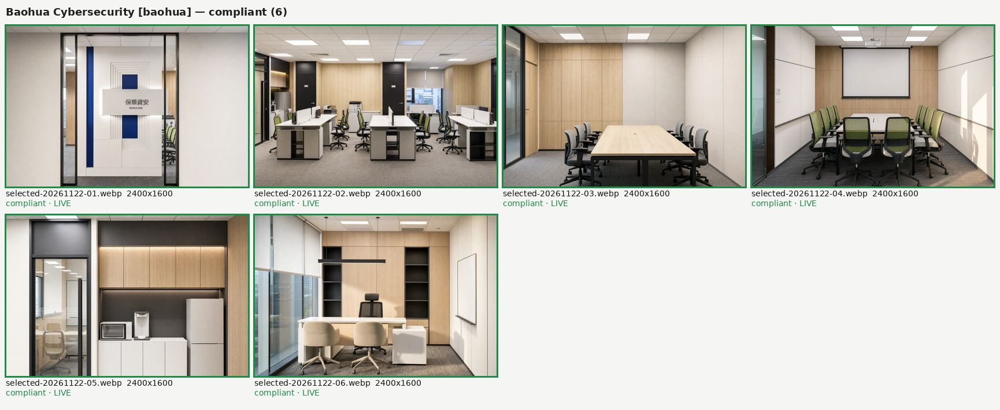

### Brightron Technology · `polytron`
<a id="polytron"></a>


### AIONTECH · `aiontech`
<a id="aiontech"></a>

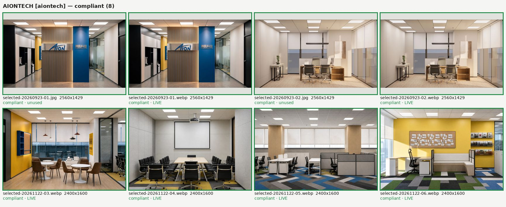

### budaejjigae · `budaejjigae`
<a id="budaejjigae"></a>

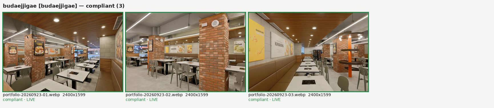

### burger-ray · `burger-ray`
<a id="burger-ray"></a>

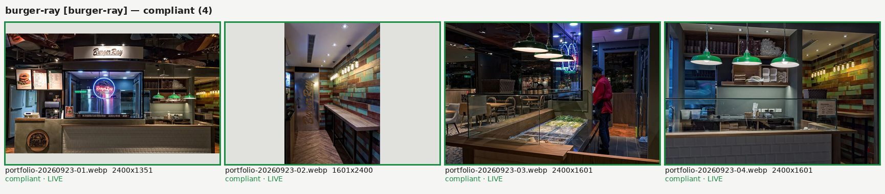

### csun · `csun`
<a id="csun"></a>

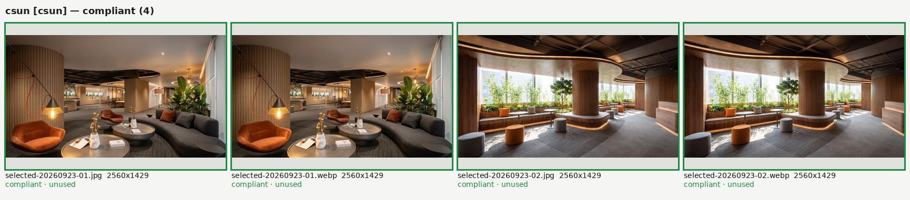

### Epic Tech · `epicstech-10f`
<a id="epicstech-10f"></a>

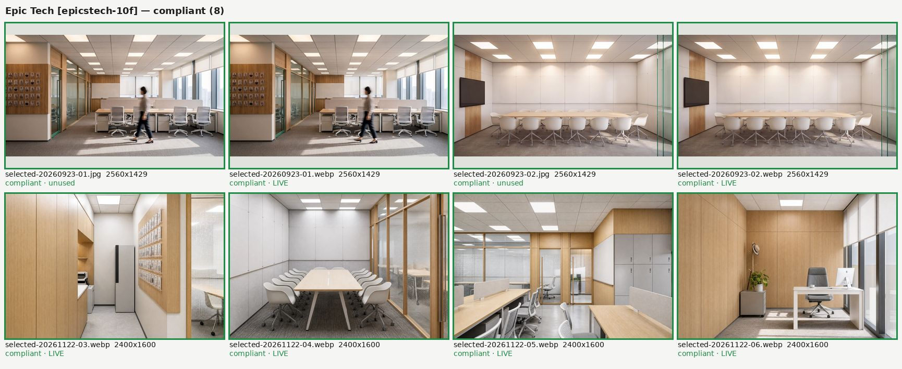

### guochan-office · `guochan-office`
<a id="guochan-office"></a>

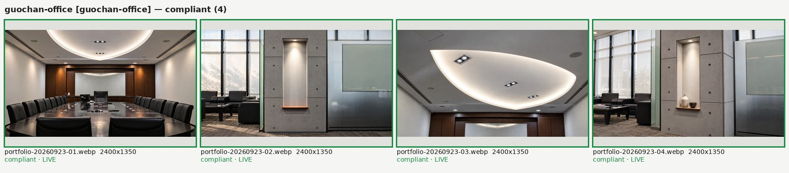

### guochan-showroom · `guochan-showroom`
<a id="guochan-showroom"></a>

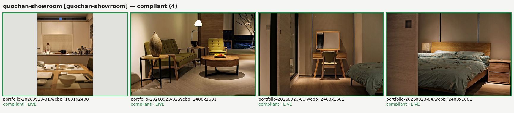

### HQ Design Office & Material Library · `hq-office`
<a id="hq-office"></a>

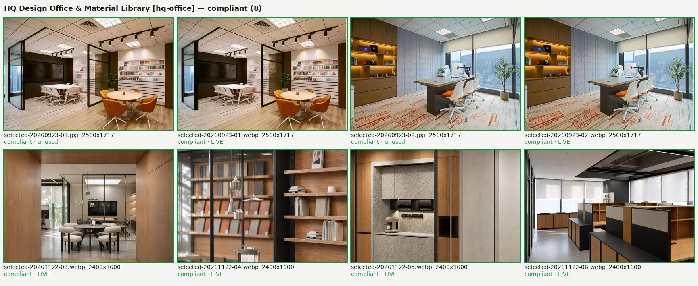

### Kimpton Da An Hotel · `kimpton`
<a id="kimpton"></a>

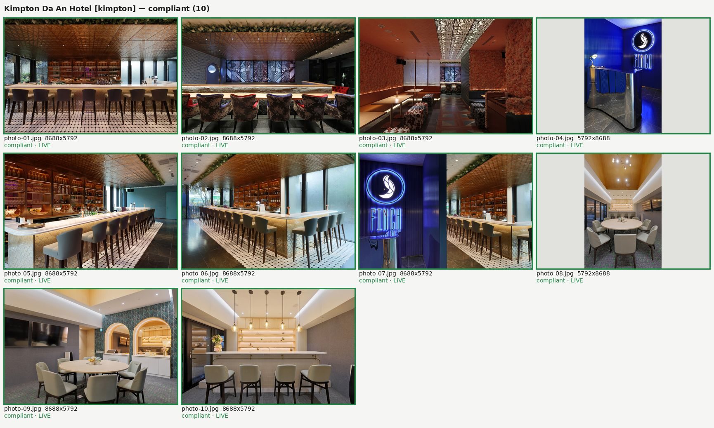

### Lots Home Entertainment · `ledaojia`
<a id="ledaojia"></a>

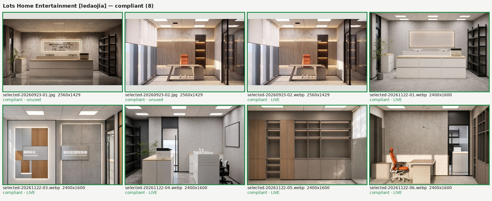

### Lijie International · `lijie`
<a id="lijie"></a>

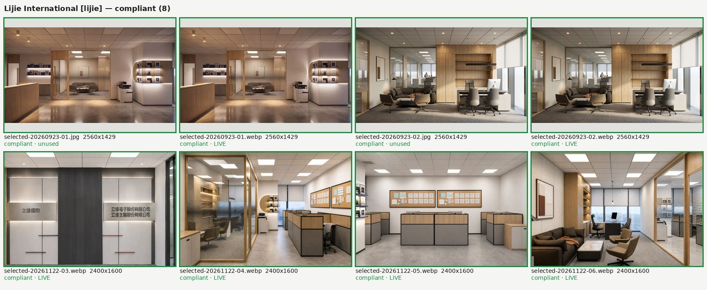

### Liwei Electronics · `liwei`
<a id="liwei"></a>


### longteng-travel · `longteng-travel`
<a id="longteng-travel"></a>

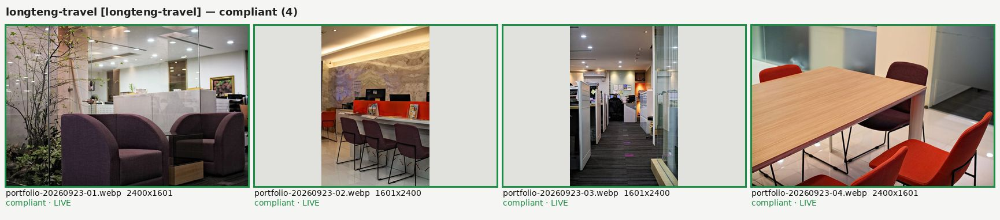

### Popeyes Xuchang Street · `popeyes`
<a id="popeyes"></a>

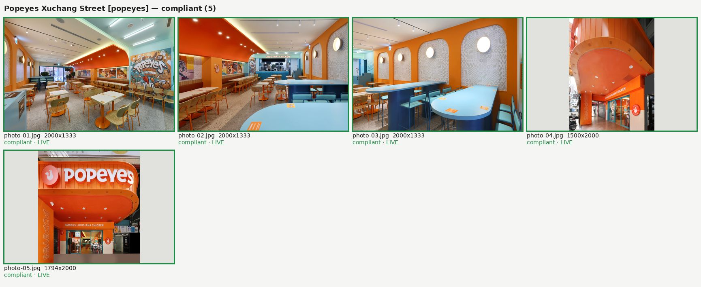

### Cheogajip, Taichung · `qijia`
<a id="qijia"></a>

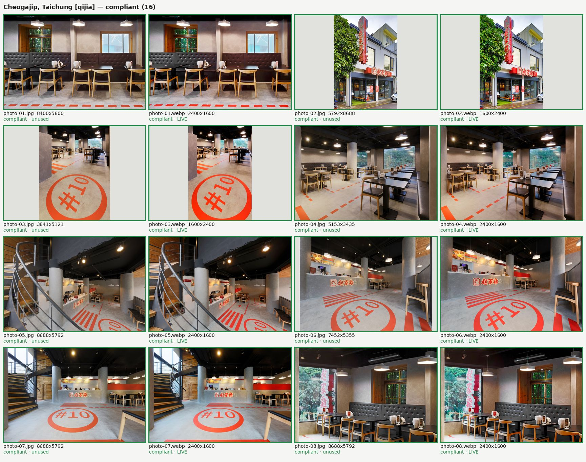

### SECOM Nangang HQ · `secom-nangang-complex`
<a id="secom-nangang-complex"></a>

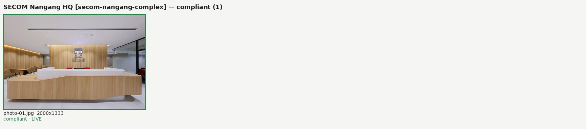

### secom-reception · `secom-reception`
<a id="secom-reception"></a>

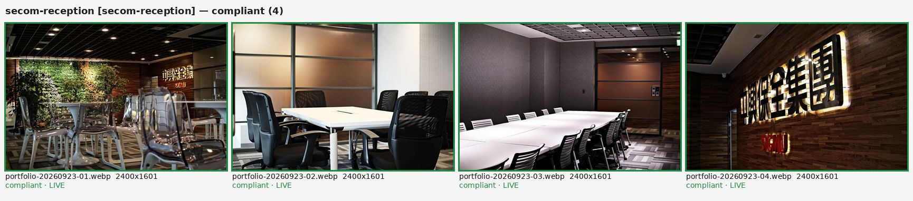

### The Soup Spoon, Taipei 101 · `soup-spoon-101`
<a id="soup-spoon-101"></a>

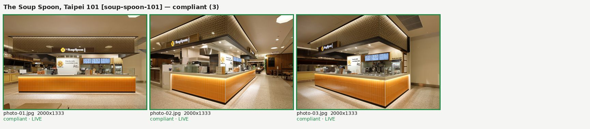

### The Soup Spoon, Taipei Main Station · `soup-spoon-station`
<a id="soup-spoon-station"></a>

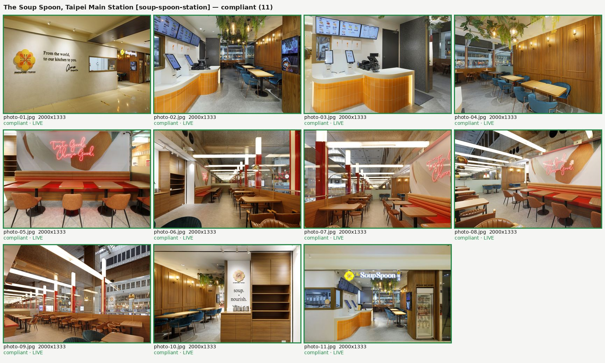

### transasia-bakery-chunri · `transasia-bakery-chunri`
<a id="transasia-bakery-chunri"></a>

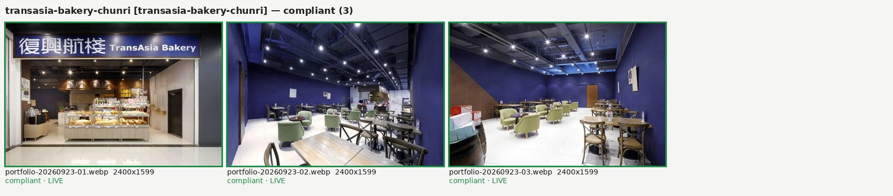

### Xinlan Enterprise · `xinlan`
<a id="xinlan"></a>


### Zhong Bao Insurance Services · `zhongbao-baojing`
<a id="zhongbao-baojing"></a>

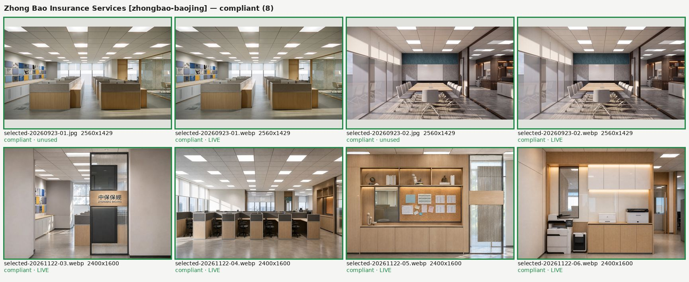

### Ching Dian TECH · `zhongbao-jingzhen`
<a id="zhongbao-jingzhen"></a>


### SECOM Technology Hall · `zhongbao-showroom`
<a id="zhongbao-showroom"></a>


### zhongbao-smart-facility · `zhongbao-smart-facility`
<a id="zhongbao-smart-facility"></a>

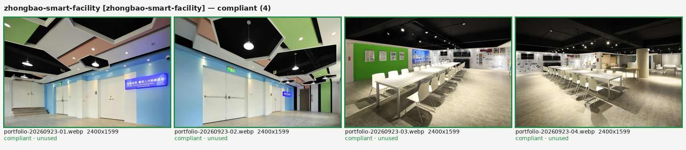

### zhongbao-store-daan · `zhongbao-store-daan`
<a id="zhongbao-store-daan"></a>

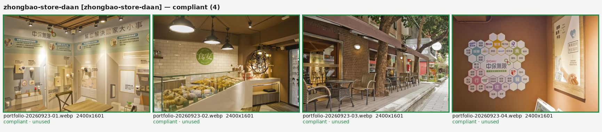

### zhongbao-store-zhuangjing · `zhongbao-store-zhuangjing`
<a id="zhongbao-store-zhuangjing"></a>

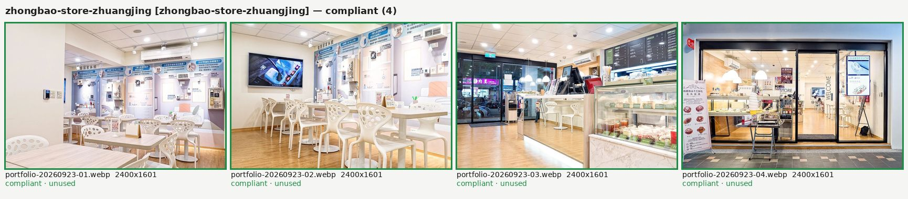

### eSkylink · `zhongbao-tianhe`
<a id="zhongbao-tianhe"></a>

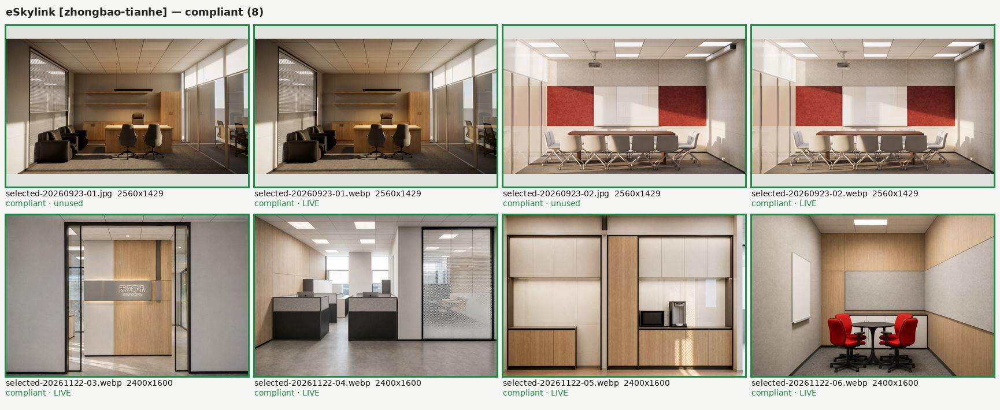

## 5. 待人工複核（目視新發現）

| 檔案 | 狀況 | 處理 |
|---|---|---|
| `ledaojia/selected-20260923-01.webp` | 內容瑕疵：招牌文字為 AI 亂碼（NNOVANON／RETHNKNG／VECMNOLOGY／IVE），規格合格但不宜作 hero | 已改列**不合格**；2026-11-22 以 OpenAI 重生成 `selected-20261122-01.webp`（字牆改為無文字浮雕）並替換全站引用 |
| `zhongbao-jingzhen/selected-20260923-01.webp` | 招牌英文 JINGTIAN TECHNOLOGY 與專案名 Ching Dian TECH／京典 拼音不一致，需與業主確認品牌拼寫 | 保留合格；待確認 |
| `zhongbao-showroom/selected-20260923-02.webp` | 展牆時間軸小字（年份以外）可能為 AI 近似文字，需對照實景確認 | 保留合格；待確認 |

> 目視範圍：全部 23 張 selected 圖的總覽；招牌／文字區域僅放大檢查 ledaojia、aiontech、zhongbao-showroom、zhongbao-jingzhen。其餘 selected 圖未逐張放大。

## 6. 後續判斷：換圖 vs 重生成

`inventory.csv`／`regeneration-queue.csv` 的 `decision` 欄填入下列其一：

| 路線 | 適用 | 做法 | 風險 |
|---|---|---|---|
| **search-replace**（搜尋可用照片換圖） | 業主／設計端能提供原始效果圖、實拍，或有公開核可素材 | 依 §E.1 交件與核可流程；轉 WebP、長邊 ≥ 2400 | 需確認公開核可；等待素材 |
| **regenerate**（修正不符區域後以 OpenAI 重生） | 只有簡報截圖：以 `render-NN.jpg` 為構圖參考，去除平面圖、浮水印、留白後輸出 | OpenAI `images/edits`（`gpt-image-2` 系列）＋後製放大至 2400 px；逐張目視驗收 | 招牌／文字亂碼（如 ledaojia）；家具與原設計不一致；需業主認可為『效果圖示意』 |
| **keep** | 已合格 | 不動 | — |
| **drop** | logo 頁、平面圖（暫不顯示） | 不進相簿 | — |

已完成（2026-11-22）：13 案皆達 6 張。重生成圖為依原設計之擬真效果圖，業主已同意公開。

## 7. 重跑與檔案

```bash
python3 scripts/photo-audit/audit.py   # 需要 Pillow；重新產生本目錄全部檔案
```

- 自動判定規則：`render-NN.jpg`／`page-NN.jpg` 一律不合格；其餘檢查長邊 ≥ 2400 px、比例 16:9 或 3:2（容差 0.04）。檔案 > 600 KB 僅列 advisory。
- 目視覆核結果存於 `scripts/photo-audit/manual-review.json`（覆蓋自動判定）。
- 「合格」僅代表規格與已目視內容；公開核可狀態需另行確認（§E.1）。
