# 照片集 A／B：確認不符合標準

紅框＝不合格（簡報截圖／內容瑕疵）；橘框＝規格偏離。`LIVE`＝官網頁面目前引用，`unused`＝僅留存於 repo（構圖參考）。

**判定依據**：舊 `render-NN.jpg`（1626×1125）為簡報頁截圖——左下角疊平面圖、底部或側邊留白、左上浮水印圖示（已目視確認 baohua 全部 10 張）；`page-NN.jpg` 為 DESIGN AND BUILD logo 頁。

## A. 不符合標準

### Baohua Cybersecurity · `baohua`

P0｜上線不合格 **0**｜合格 6｜距 6 張缺 **0**

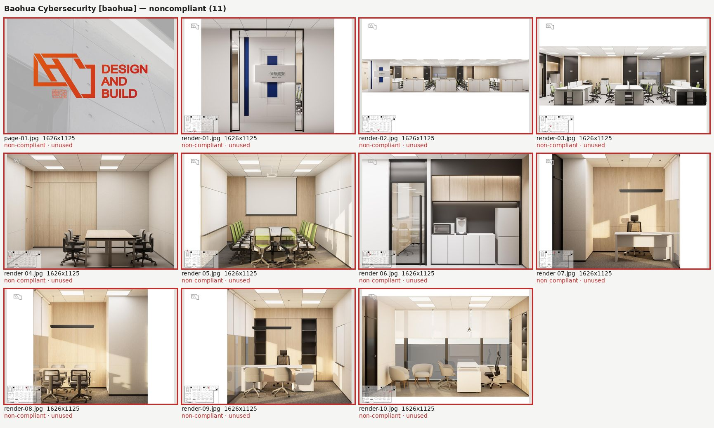

| 檔案 | 尺寸 | 狀態 | 不符原因 | 待補視角 | 建議路線 |
|---|---|---|---|---|---|
| `page-01.jpg` | 1626×1125 | unused | 簡報 logo 頁／封面截圖 | — | discard-from-gallery（logo 頁，不進相簿） |
| `render-01.jpg` | 1626×1125 | unused | 簡報截圖：內嵌平面圖／浮水印／底部留白 | 入口 hero | regenerate（OpenAI edit：以此舊稿為構圖參考，去除平面圖／浮水印／留白） |
| `render-02.jpg` | 1626×1125 | unused | 簡報截圖：內嵌平面圖／浮水印／底部留白 | — | reference-only（構圖參考；非本輪必補視角） |
| `render-03.jpg` | 1626×1125 | unused | 簡報截圖：內嵌平面圖／浮水印／底部留白 | 開放辦公區 | regenerate（OpenAI edit：以此舊稿為構圖參考，去除平面圖／浮水印／留白） |
| `render-04.jpg` | 1626×1125 | unused | 簡報截圖：內嵌平面圖／浮水印／底部留白 | 長桌會議室 | regenerate（OpenAI edit：以此舊稿為構圖參考，去除平面圖／浮水印／留白） |
| `render-05.jpg` | 1626×1125 | unused | 簡報截圖：內嵌平面圖／浮水印／底部留白 | 投影會議室 | regenerate（OpenAI edit：以此舊稿為構圖參考，去除平面圖／浮水印／留白） |
| `render-06.jpg` | 1626×1125 | unused | 簡報截圖：內嵌平面圖／浮水印／底部留白 | 茶水櫃區 | regenerate（OpenAI edit：以此舊稿為構圖參考，去除平面圖／浮水印／留白） |
| `render-07.jpg` | 1626×1125 | unused | 簡報截圖：內嵌平面圖／浮水印／底部留白 | — | reference-only（構圖參考；非本輪必補視角） |
| `render-08.jpg` | 1626×1125 | unused | 簡報截圖：內嵌平面圖／浮水印／底部留白 | — | reference-only（構圖參考；非本輪必補視角） |
| `render-09.jpg` | 1626×1125 | unused | 簡報截圖：內嵌平面圖／浮水印／底部留白 | 獨立辦公室 | regenerate（OpenAI edit：以此舊稿為構圖參考，去除平面圖／浮水印／留白） |
| `render-10.jpg` | 1626×1125 | unused | 簡報截圖：內嵌平面圖／浮水印／底部留白 | — | reference-only（構圖參考；非本輪必補視角） |

### Brightron Technology · `polytron`

P1｜上線不合格 **0**｜合格 1｜距 6 張缺 **5**

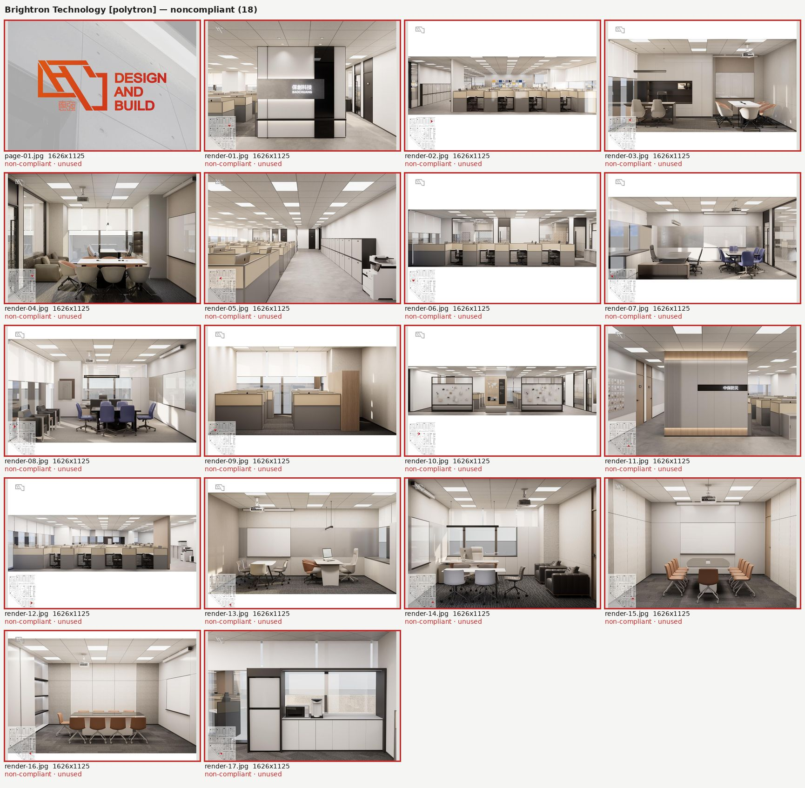

| 檔案 | 尺寸 | 狀態 | 不符原因 | 待補視角 | 建議路線 |
|---|---|---|---|---|---|
| `page-01.jpg` | 1626×1125 | unused | 簡報 logo 頁／封面截圖 | — | discard-from-gallery（logo 頁，不進相簿） |
| `render-01.jpg` | 1626×1125 | unused | 簡報截圖：內嵌平面圖／浮水印／底部留白 | — | reference-only（構圖參考；非本輪必補視角） |
| `render-02.jpg` | 1626×1125 | unused | 簡報截圖：內嵌平面圖／浮水印／底部留白 | — | reference-only（構圖參考；非本輪必補視角） |
| `render-03.jpg` | 1626×1125 | unused | 簡報截圖：內嵌平面圖／浮水印／底部留白 | — | reference-only（構圖參考；非本輪必補視角） |
| `render-04.jpg` | 1626×1125 | unused | 簡報截圖：內嵌平面圖／浮水印／底部留白 | — | reference-only（構圖參考；非本輪必補視角） |
| `render-05.jpg` | 1626×1125 | unused | 簡報截圖：內嵌平面圖／浮水印／底部留白 | 收納走道 | regenerate（OpenAI edit：以此舊稿為構圖參考，去除平面圖／浮水印／留白） |
| `render-06.jpg` | 1626×1125 | unused | 簡報截圖：內嵌平面圖／浮水印／底部留白 | 開放工位全景 | regenerate（OpenAI edit：以此舊稿為構圖參考，去除平面圖／浮水印／留白） |
| `render-07.jpg` | 1626×1125 | unused | 簡報截圖：內嵌平面圖／浮水印／底部留白 | — | reference-only（構圖參考；非本輪必補視角） |
| `render-08.jpg` | 1626×1125 | unused | 簡報截圖：內嵌平面圖／浮水印／底部留白 | — | reference-only（構圖參考；非本輪必補視角） |
| `render-09.jpg` | 1626×1125 | unused | 簡報截圖：內嵌平面圖／浮水印／底部留白 | — | reference-only（構圖參考；非本輪必補視角） |
| `render-10.jpg` | 1626×1125 | unused | 簡報截圖：內嵌平面圖／浮水印／底部留白 | — | reference-only（構圖參考；非本輪必補視角） |
| `render-11.jpg` | 1626×1125 | unused | 簡報截圖：內嵌平面圖／浮水印／底部留白 | — | reference-only（構圖參考；非本輪必補視角） |
| `render-12.jpg` | 1626×1125 | unused | 簡報截圖：內嵌平面圖／浮水印／底部留白 | — | reference-only（構圖參考；非本輪必補視角） |
| `render-13.jpg` | 1626×1125 | unused | 簡報截圖：內嵌平面圖／浮水印／底部留白 | — | reference-only（構圖參考；非本輪必補視角） |
| `render-14.jpg` | 1626×1125 | unused | 簡報截圖：內嵌平面圖／浮水印／底部留白 | 主管室 | regenerate（OpenAI edit：以此舊稿為構圖參考，去除平面圖／浮水印／留白） |
| `render-15.jpg` | 1626×1125 | unused | 簡報截圖：內嵌平面圖／浮水印／底部留白 | 大會議室 | regenerate（OpenAI edit：以此舊稿為構圖參考，去除平面圖／浮水印／留白） |
| `render-16.jpg` | 1626×1125 | unused | 簡報截圖：內嵌平面圖／浮水印／底部留白 | — | reference-only（構圖參考；非本輪必補視角） |
| `render-17.jpg` | 1626×1125 | unused | 簡報截圖：內嵌平面圖／浮水印／底部留白 | 茶水區 | regenerate（OpenAI edit：以此舊稿為構圖參考，去除平面圖／浮水印／留白） |

### AIONTECH · `aiontech`

P1｜上線不合格 **0**｜合格 2｜距 6 張缺 **4**

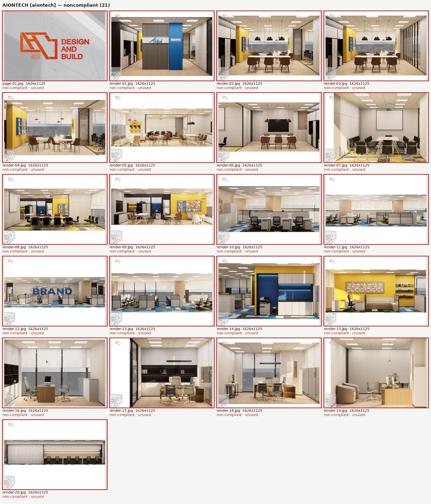

| 檔案 | 尺寸 | 狀態 | 不符原因 | 待補視角 | 建議路線 |
|---|---|---|---|---|---|
| `page-01.jpg` | 1626×1125 | unused | 簡報 logo 頁／封面截圖 | — | discard-from-gallery（logo 頁，不進相簿） |
| `render-01.jpg` | 1626×1125 | unused | 簡報截圖：內嵌平面圖／浮水印／底部留白 | — | reference-only（構圖參考；非本輪必補視角） |
| `render-02.jpg` | 1626×1125 | unused | 簡報截圖：內嵌平面圖／浮水印／底部留白 | — | reference-only（構圖參考；非本輪必補視角） |
| `render-03.jpg` | 1626×1125 | unused | 簡報截圖：內嵌平面圖／浮水印／底部留白 | — | reference-only（構圖參考；非本輪必補視角） |
| `render-04.jpg` | 1626×1125 | unused | 簡報截圖：內嵌平面圖／浮水印／底部留白 | 黃色協作區 | regenerate（OpenAI edit：以此舊稿為構圖參考，去除平面圖／浮水印／留白） |
| `render-05.jpg` | 1626×1125 | unused | 簡報截圖：內嵌平面圖／浮水印／底部留白 | — | reference-only（構圖參考；非本輪必補視角） |
| `render-06.jpg` | 1626×1125 | unused | 簡報截圖：內嵌平面圖／浮水印／底部留白 | — | reference-only（構圖參考；非本輪必補視角） |
| `render-07.jpg` | 1626×1125 | unused | 簡報截圖：內嵌平面圖／浮水印／底部留白 | 投影會議室 | regenerate（OpenAI edit：以此舊稿為構圖參考，去除平面圖／浮水印／留白） |
| `render-08.jpg` | 1626×1125 | unused | 簡報截圖：內嵌平面圖／浮水印／底部留白 | — | reference-only（構圖參考；非本輪必補視角） |
| `render-09.jpg` | 1626×1125 | unused | 簡報截圖：內嵌平面圖／浮水印／底部留白 | — | reference-only（構圖參考；非本輪必補視角） |
| `render-10.jpg` | 1626×1125 | unused | 簡報截圖：內嵌平面圖／浮水印／底部留白 | — | reference-only（構圖參考；非本輪必補視角） |
| `render-11.jpg` | 1626×1125 | unused | 簡報截圖：內嵌平面圖／浮水印／底部留白 | 開放工位 | regenerate（OpenAI edit：以此舊稿為構圖參考，去除平面圖／浮水印／留白） |
| `render-12.jpg` | 1626×1125 | unused | 簡報截圖：內嵌平面圖／浮水印／底部留白 | — | reference-only（構圖參考；非本輪必補視角） |
| `render-13.jpg` | 1626×1125 | unused | 簡報截圖：內嵌平面圖／浮水印／底部留白 | — | reference-only（構圖參考；非本輪必補視角） |
| `render-14.jpg` | 1626×1125 | unused | 簡報截圖：內嵌平面圖／浮水印／底部留白 | — | reference-only（構圖參考；非本輪必補視角） |
| `render-15.jpg` | 1626×1125 | unused | 簡報截圖：內嵌平面圖／浮水印／底部留白 | 休憩區 | regenerate（OpenAI edit：以此舊稿為構圖參考，去除平面圖／浮水印／留白） |
| `render-16.jpg` | 1626×1125 | unused | 簡報截圖：內嵌平面圖／浮水印／底部留白 | — | reference-only（構圖參考；非本輪必補視角） |
| `render-17.jpg` | 1626×1125 | unused | 簡報截圖：內嵌平面圖／浮水印／底部留白 | — | reference-only（構圖參考；非本輪必補視角） |
| `render-18.jpg` | 1626×1125 | unused | 簡報截圖：內嵌平面圖／浮水印／底部留白 | — | reference-only（構圖參考；非本輪必補視角） |
| `render-19.jpg` | 1626×1125 | unused | 簡報截圖：內嵌平面圖／浮水印／底部留白 | — | reference-only（構圖參考；非本輪必補視角） |
| `render-20.jpg` | 1626×1125 | unused | 簡報截圖：內嵌平面圖／浮水印／底部留白 | — | reference-only（構圖參考；非本輪必補視角） |

### Epic Tech · `epicstech-10f`

P1｜上線不合格 **0**｜合格 2｜距 6 張缺 **4**

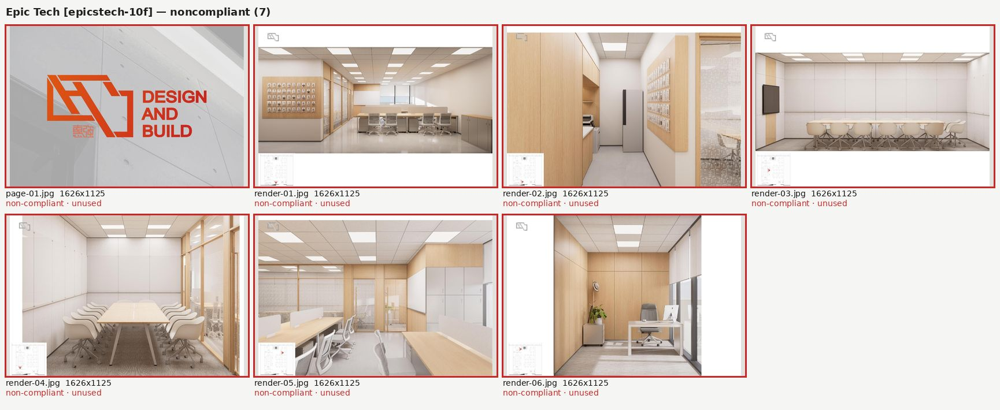

| 檔案 | 尺寸 | 狀態 | 不符原因 | 待補視角 | 建議路線 |
|---|---|---|---|---|---|
| `page-01.jpg` | 1626×1125 | unused | 簡報 logo 頁／封面截圖 | — | discard-from-gallery（logo 頁，不進相簿） |
| `render-01.jpg` | 1626×1125 | unused | 簡報截圖：內嵌平面圖／浮水印／底部留白 | — | reference-only（構圖參考；非本輪必補視角） |
| `render-02.jpg` | 1626×1125 | unused | 簡報截圖：內嵌平面圖／浮水印／底部留白 | 木牆走廊 | regenerate（OpenAI edit：以此舊稿為構圖參考，去除平面圖／浮水印／留白） |
| `render-03.jpg` | 1626×1125 | unused | 簡報截圖：內嵌平面圖／浮水印／底部留白 | — | reference-only（構圖參考；非本輪必補視角） |
| `render-04.jpg` | 1626×1125 | unused | 簡報截圖：內嵌平面圖／浮水印／底部留白 | 長桌會議室縱向 | regenerate（OpenAI edit：以此舊稿為構圖參考，去除平面圖／浮水印／留白） |
| `render-05.jpg` | 1626×1125 | unused | 簡報截圖：內嵌平面圖／浮水印／底部留白 | 會議區側景 | regenerate（OpenAI edit：以此舊稿為構圖參考，去除平面圖／浮水印／留白） |
| `render-06.jpg` | 1626×1125 | unused | 簡報截圖：內嵌平面圖／浮水印／底部留白 | 獨立辦公室 | regenerate（OpenAI edit：以此舊稿為構圖參考，去除平面圖／浮水印／留白） |

### HQ Design Office & Material Library · `hq-office`

P1｜上線不合格 **0**｜合格 2｜距 6 張缺 **4**

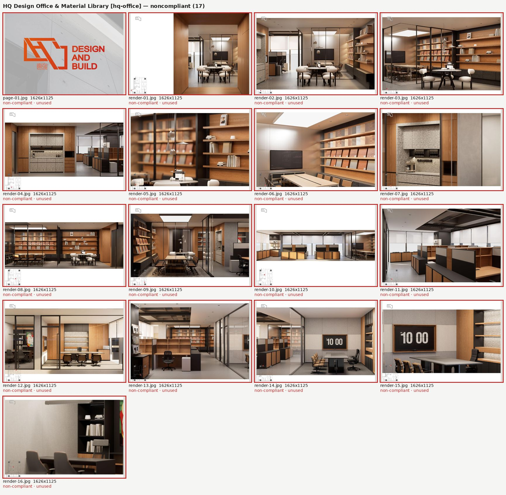

| 檔案 | 尺寸 | 狀態 | 不符原因 | 待補視角 | 建議路線 |
|---|---|---|---|---|---|
| `page-01.jpg` | 1626×1125 | unused | 簡報 logo 頁／封面截圖 | — | discard-from-gallery（logo 頁，不進相簿） |
| `render-01.jpg` | 1626×1125 | unused | 簡報截圖：內嵌平面圖／浮水印／底部留白 | 入口看向材料圖書館 | regenerate（OpenAI edit：以此舊稿為構圖參考，去除平面圖／浮水印／留白） |
| `render-02.jpg` | 1626×1125 | unused | 簡報截圖：內嵌平面圖／浮水印／底部留白 | — | reference-only（構圖參考；非本輪必補視角） |
| `render-03.jpg` | 1626×1125 | unused | 簡報截圖：內嵌平面圖／浮水印／底部留白 | — | reference-only（構圖參考；非本輪必補視角） |
| `render-04.jpg` | 1626×1125 | unused | 簡報截圖：內嵌平面圖／浮水印／底部留白 | — | reference-only（構圖參考；非本輪必補視角） |
| `render-05.jpg` | 1626×1125 | unused | 簡報截圖：內嵌平面圖／浮水印／底部留白 | 材料展示架 | regenerate（OpenAI edit：以此舊稿為構圖參考，去除平面圖／浮水印／留白） |
| `render-06.jpg` | 1626×1125 | unused | 簡報截圖：內嵌平面圖／浮水印／底部留白 | — | reference-only（構圖參考；非本輪必補視角） |
| `render-07.jpg` | 1626×1125 | unused | 簡報截圖：內嵌平面圖／浮水印／底部留白 | 茶水區 | regenerate（OpenAI edit：以此舊稿為構圖參考，去除平面圖／浮水印／留白） |
| `render-08.jpg` | 1626×1125 | unused | 簡報截圖：內嵌平面圖／浮水印／底部留白 | — | reference-only（構圖參考；非本輪必補視角） |
| `render-09.jpg` | 1626×1125 | unused | 簡報截圖：內嵌平面圖／浮水印／底部留白 | — | reference-only（構圖參考；非本輪必補視角） |
| `render-10.jpg` | 1626×1125 | unused | 簡報截圖：內嵌平面圖／浮水印／底部留白 | — | reference-only（構圖參考；非本輪必補視角） |
| `render-11.jpg` | 1626×1125 | unused | 簡報截圖：內嵌平面圖／浮水印／底部留白 | 開放工位 | regenerate（OpenAI edit：以此舊稿為構圖參考，去除平面圖／浮水印／留白） |
| `render-12.jpg` | 1626×1125 | unused | 簡報截圖：內嵌平面圖／浮水印／底部留白 | — | reference-only（構圖參考；非本輪必補視角） |
| `render-13.jpg` | 1626×1125 | unused | 簡報截圖：內嵌平面圖／浮水印／底部留白 | — | reference-only（構圖參考；非本輪必補視角） |
| `render-14.jpg` | 1626×1125 | unused | 簡報截圖：內嵌平面圖／浮水印／底部留白 | — | reference-only（構圖參考；非本輪必補視角） |
| `render-15.jpg` | 1626×1125 | unused | 簡報截圖：內嵌平面圖／浮水印／底部留白 | — | reference-only（構圖參考；非本輪必補視角） |
| `render-16.jpg` | 1626×1125 | unused | 簡報截圖：內嵌平面圖／浮水印／底部留白 | — | reference-only（構圖參考；非本輪必補視角） |

### Lots Home Entertainment · `ledaojia`

P1｜上線不合格 **0**｜合格 2｜距 6 張缺 **4**

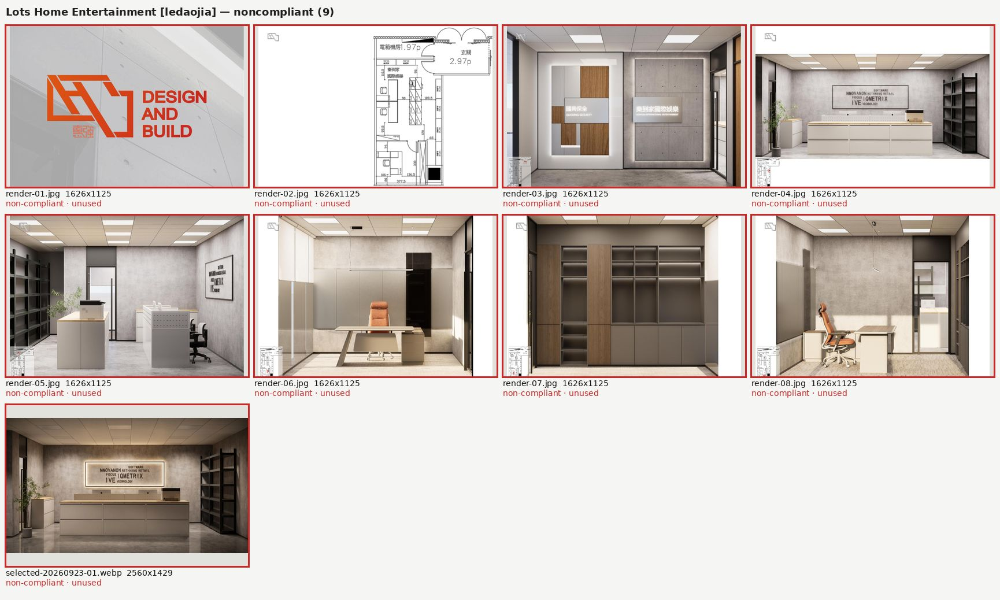

| 檔案 | 尺寸 | 狀態 | 不符原因 | 待補視角 | 建議路線 |
|---|---|---|---|---|---|
| `render-01.jpg` | 1626×1125 | unused | 簡報截圖：內嵌平面圖／浮水印／底部留白 | — | reference-only（構圖參考；非本輪必補視角） |
| `render-02.jpg` | 1626×1125 | unused | 簡報截圖：內嵌平面圖／浮水印／底部留白 | — | reference-only（構圖參考；非本輪必補視角） |
| `render-03.jpg` | 1626×1125 | unused | 簡報截圖：內嵌平面圖／浮水印／底部留白 | 入口門廳 | regenerate（OpenAI edit：以此舊稿為構圖參考，去除平面圖／浮水印／留白） |
| `render-04.jpg` | 1626×1125 | unused | 簡報截圖：內嵌平面圖／浮水印／底部留白 | — | reference-only（構圖參考；非本輪必補視角） |
| `render-05.jpg` | 1626×1125 | unused | 簡報截圖：內嵌平面圖／浮水印／底部留白 | 辦公工位 | regenerate（OpenAI edit：以此舊稿為構圖參考，去除平面圖／浮水印／留白） |
| `render-06.jpg` | 1626×1125 | unused | 簡報截圖：內嵌平面圖／浮水印／底部留白 | — | reference-only（構圖參考；非本輪必補視角） |
| `render-07.jpg` | 1626×1125 | unused | 簡報截圖：內嵌平面圖／浮水印／底部留白 | 展示櫃 | regenerate（OpenAI edit：以此舊稿為構圖參考，去除平面圖／浮水印／留白） |
| `render-08.jpg` | 1626×1125 | unused | 簡報截圖：內嵌平面圖／浮水印／底部留白 | 獨立辦公室側景 | regenerate（OpenAI edit：以此舊稿為構圖參考，去除平面圖／浮水印／留白） |
| `selected-20260923-01.webp` | 2560×1429 | unused | 內容瑕疵：招牌文字為 AI 亂碼（NNOVANON／RETHNKNG／VECMNOLOGY／IVE），規格合格但不宜作 hero | 入口接待（重生：招牌文字改用實際 logo／真實字樣，或留白） | regenerate（OpenAI edit：以此舊稿為構圖參考，去除平面圖／浮水印／留白） |

### Lijie International · `lijie`

P1｜上線不合格 **0**｜合格 2｜距 6 張缺 **4**

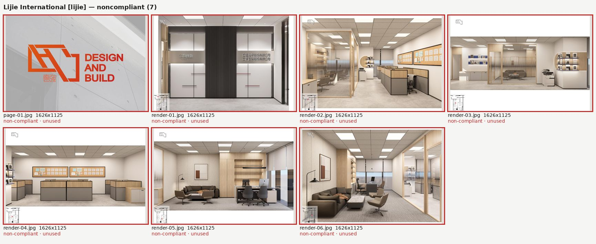

| 檔案 | 尺寸 | 狀態 | 不符原因 | 待補視角 | 建議路線 |
|---|---|---|---|---|---|
| `page-01.jpg` | 1626×1125 | unused | 簡報 logo 頁／封面截圖 | — | discard-from-gallery（logo 頁，不進相簿） |
| `render-01.jpg` | 1626×1125 | unused | 簡報截圖：內嵌平面圖／浮水印／底部留白 | 入口門廳 | regenerate（OpenAI edit：以此舊稿為構圖參考，去除平面圖／浮水印／留白） |
| `render-02.jpg` | 1626×1125 | unused | 簡報截圖：內嵌平面圖／浮水印／底部留白 | 玻璃隔間走道 | regenerate（OpenAI edit：以此舊稿為構圖參考，去除平面圖／浮水印／留白） |
| `render-03.jpg` | 1626×1125 | unused | 簡報截圖：內嵌平面圖／浮水印／底部留白 | — | reference-only（構圖參考；非本輪必補視角） |
| `render-04.jpg` | 1626×1125 | unused | 簡報截圖：內嵌平面圖／浮水印／底部留白 | 開放工位 | regenerate（OpenAI edit：以此舊稿為構圖參考，去除平面圖／浮水印／留白） |
| `render-05.jpg` | 1626×1125 | unused | 簡報截圖：內嵌平面圖／浮水印／底部留白 | — | reference-only（構圖參考；非本輪必補視角） |
| `render-06.jpg` | 1626×1125 | unused | 簡報截圖：內嵌平面圖／浮水印／底部留白 | 訪客沙發側景 | regenerate（OpenAI edit：以此舊稿為構圖參考，去除平面圖／浮水印／留白） |

### Liwei Electronics · `liwei`

P1｜上線不合格 **0**｜合格 2｜距 6 張缺 **4**

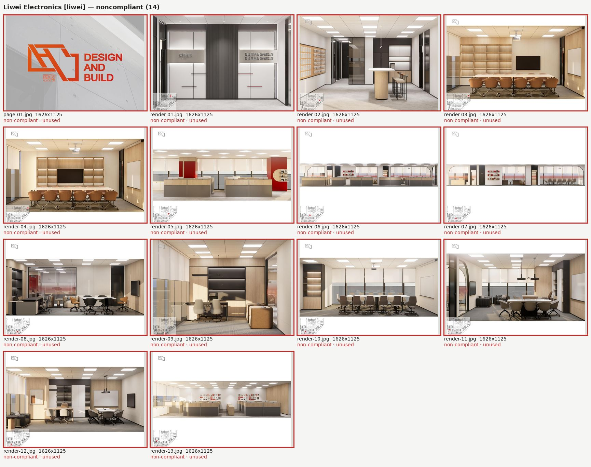

| 檔案 | 尺寸 | 狀態 | 不符原因 | 待補視角 | 建議路線 |
|---|---|---|---|---|---|
| `page-01.jpg` | 1626×1125 | unused | 簡報 logo 頁／封面截圖 | — | discard-from-gallery（logo 頁，不進相簿） |
| `render-01.jpg` | 1626×1125 | unused | 簡報截圖：內嵌平面圖／浮水印／底部留白 | 入口門廳 | regenerate（OpenAI edit：以此舊稿為構圖參考，去除平面圖／浮水印／留白） |
| `render-02.jpg` | 1626×1125 | unused | 簡報截圖：內嵌平面圖／浮水印／底部留白 | 協作吧檯 | regenerate（OpenAI edit：以此舊稿為構圖參考，去除平面圖／浮水印／留白） |
| `render-03.jpg` | 1626×1125 | unused | 簡報截圖：內嵌平面圖／浮水印／底部留白 | — | reference-only（構圖參考；非本輪必補視角） |
| `render-04.jpg` | 1626×1125 | unused | 簡報截圖：內嵌平面圖／浮水印／底部留白 | — | reference-only（構圖參考；非本輪必補視角） |
| `render-05.jpg` | 1626×1125 | unused | 簡報截圖：內嵌平面圖／浮水印／底部留白 | — | reference-only（構圖參考；非本輪必補視角） |
| `render-06.jpg` | 1626×1125 | unused | 簡報截圖：內嵌平面圖／浮水印／底部留白 | — | reference-only（構圖參考；非本輪必補視角） |
| `render-07.jpg` | 1626×1125 | unused | 簡報截圖：內嵌平面圖／浮水印／底部留白 | — | reference-only（構圖參考；非本輪必補視角） |
| `render-08.jpg` | 1626×1125 | unused | 簡報截圖：內嵌平面圖／浮水印／底部留白 | — | reference-only（構圖參考；非本輪必補視角） |
| `render-09.jpg` | 1626×1125 | unused | 簡報截圖：內嵌平面圖／浮水印／底部留白 | 獨立辦公室 | regenerate（OpenAI edit：以此舊稿為構圖參考，去除平面圖／浮水印／留白） |
| `render-10.jpg` | 1626×1125 | unused | 簡報截圖：內嵌平面圖／浮水印／底部留白 | 窗邊會議區 | regenerate（OpenAI edit：以此舊稿為構圖參考，去除平面圖／浮水印／留白） |
| `render-11.jpg` | 1626×1125 | unused | 簡報截圖：內嵌平面圖／浮水印／底部留白 | — | reference-only（構圖參考；非本輪必補視角） |
| `render-12.jpg` | 1626×1125 | unused | 簡報截圖：內嵌平面圖／浮水印／底部留白 | — | reference-only（構圖參考；非本輪必補視角） |
| `render-13.jpg` | 1626×1125 | unused | 簡報截圖：內嵌平面圖／浮水印／底部留白 | — | reference-only（構圖參考；非本輪必補視角） |

### Xinlan Enterprise · `xinlan`

P1｜上線不合格 **0**｜合格 2｜距 6 張缺 **4**

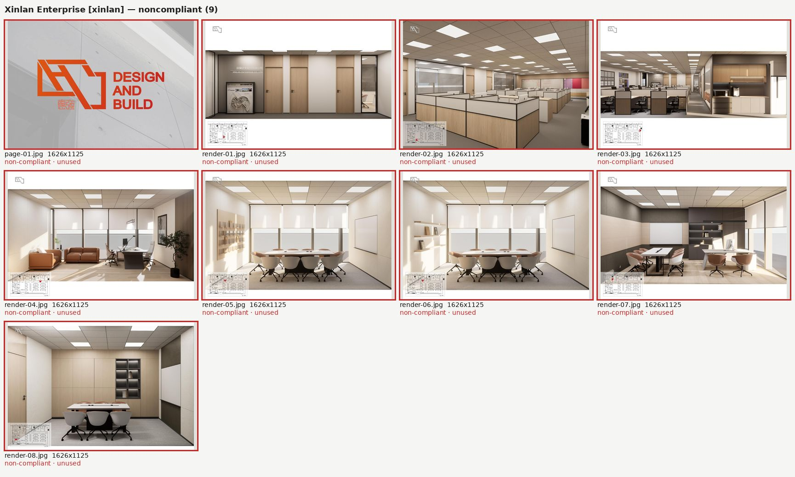

| 檔案 | 尺寸 | 狀態 | 不符原因 | 待補視角 | 建議路線 |
|---|---|---|---|---|---|
| `page-01.jpg` | 1626×1125 | unused | 簡報 logo 頁／封面截圖 | — | discard-from-gallery（logo 頁，不進相簿） |
| `render-01.jpg` | 1626×1125 | unused | 簡報截圖：內嵌平面圖／浮水印／底部留白 | 入口走廊 | regenerate（OpenAI edit：以此舊稿為構圖參考，去除平面圖／浮水印／留白） |
| `render-02.jpg` | 1626×1125 | unused | 簡報截圖：內嵌平面圖／浮水印／底部留白 | — | reference-only（構圖參考；非本輪必補視角） |
| `render-03.jpg` | 1626×1125 | unused | 簡報截圖：內嵌平面圖／浮水印／底部留白 | 開放工位反向 | regenerate（OpenAI edit：以此舊稿為構圖參考，去除平面圖／浮水印／留白） |
| `render-04.jpg` | 1626×1125 | unused | 簡報截圖：內嵌平面圖／浮水印／底部留白 | — | reference-only（構圖參考；非本輪必補視角） |
| `render-05.jpg` | 1626×1125 | unused | 簡報截圖：內嵌平面圖／浮水印／底部留白 | 窗邊長桌會議室 | regenerate（OpenAI edit：以此舊稿為構圖參考，去除平面圖／浮水印／留白） |
| `render-06.jpg` | 1626×1125 | unused | 簡報截圖：內嵌平面圖／浮水印／底部留白 | — | reference-only（構圖參考；非本輪必補視角） |
| `render-07.jpg` | 1626×1125 | unused | 簡報截圖：內嵌平面圖／浮水印／底部留白 | — | reference-only（構圖參考；非本輪必補視角） |
| `render-08.jpg` | 1626×1125 | unused | 簡報截圖：內嵌平面圖／浮水印／底部留白 | 小會議室 | regenerate（OpenAI edit：以此舊稿為構圖參考，去除平面圖／浮水印／留白） |

### Zhong Bao Insurance Services · `zhongbao-baojing`

P1｜上線不合格 **0**｜合格 2｜距 6 張缺 **4**

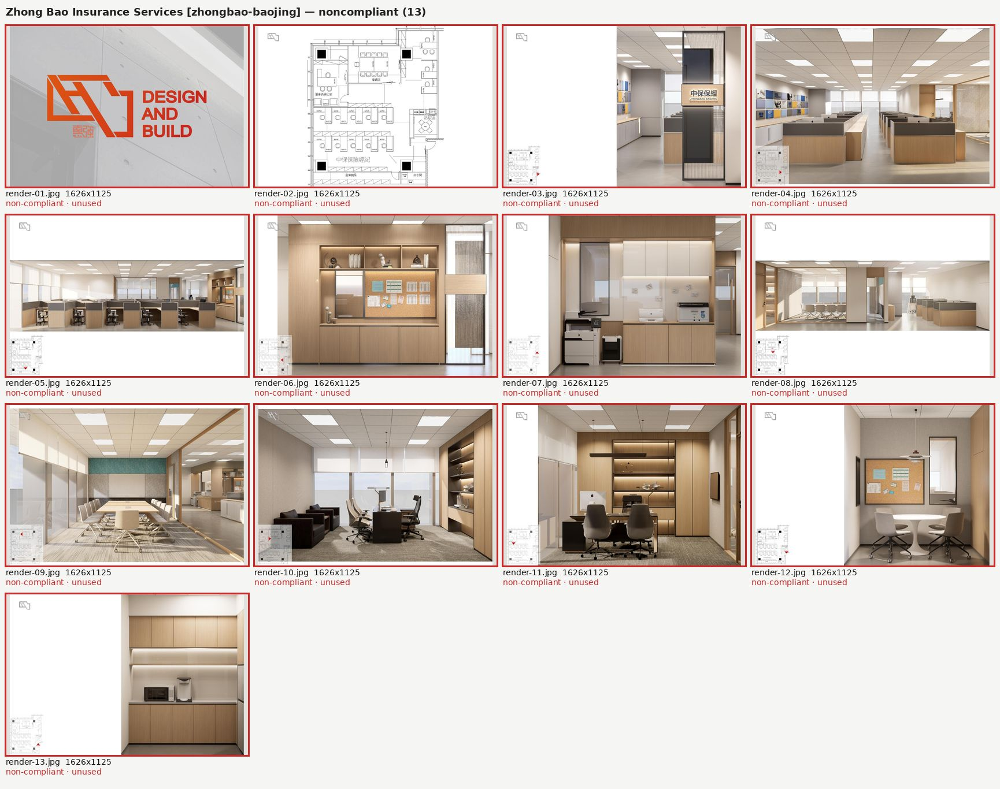

| 檔案 | 尺寸 | 狀態 | 不符原因 | 待補視角 | 建議路線 |
|---|---|---|---|---|---|
| `render-01.jpg` | 1626×1125 | unused | 簡報截圖：內嵌平面圖／浮水印／底部留白 | — | reference-only（構圖參考；非本輪必補視角） |
| `render-02.jpg` | 1626×1125 | unused | 簡報截圖：內嵌平面圖／浮水印／底部留白 | — | reference-only（構圖參考；非本輪必補視角） |
| `render-03.jpg` | 1626×1125 | unused | 簡報截圖：內嵌平面圖／浮水印／底部留白 | 入口 | regenerate（OpenAI edit：以此舊稿為構圖參考，去除平面圖／浮水印／留白） |
| `render-04.jpg` | 1626×1125 | unused | 簡報截圖：內嵌平面圖／浮水印／底部留白 | — | reference-only（構圖參考；非本輪必補視角） |
| `render-05.jpg` | 1626×1125 | unused | 簡報截圖：內嵌平面圖／浮水印／底部留白 | 開放工位側景 | regenerate（OpenAI edit：以此舊稿為構圖參考，去除平面圖／浮水印／留白） |
| `render-06.jpg` | 1626×1125 | unused | 簡報截圖：內嵌平面圖／浮水印／底部留白 | 展示公告櫃 | regenerate（OpenAI edit：以此舊稿為構圖參考，去除平面圖／浮水印／留白） |
| `render-07.jpg` | 1626×1125 | unused | 簡報截圖：內嵌平面圖／浮水印／底部留白 | 茶水區 | regenerate（OpenAI edit：以此舊稿為構圖參考，去除平面圖／浮水印／留白） |
| `render-08.jpg` | 1626×1125 | unused | 簡報截圖：內嵌平面圖／浮水印／底部留白 | — | reference-only（構圖參考；非本輪必補視角） |
| `render-09.jpg` | 1626×1125 | unused | 簡報截圖：內嵌平面圖／浮水印／底部留白 | — | reference-only（構圖參考；非本輪必補視角） |
| `render-10.jpg` | 1626×1125 | unused | 簡報截圖：內嵌平面圖／浮水印／底部留白 | — | reference-only（構圖參考；非本輪必補視角） |
| `render-11.jpg` | 1626×1125 | unused | 簡報截圖：內嵌平面圖／浮水印／底部留白 | — | reference-only（構圖參考；非本輪必補視角） |
| `render-12.jpg` | 1626×1125 | unused | 簡報截圖：內嵌平面圖／浮水印／底部留白 | — | reference-only（構圖參考；非本輪必補視角） |
| `render-13.jpg` | 1626×1125 | unused | 簡報截圖：內嵌平面圖／浮水印／底部留白 | — | reference-only（構圖參考；非本輪必補視角） |

### Ching Dian TECH · `zhongbao-jingzhen`

P1｜上線不合格 **0**｜合格 2｜距 6 張缺 **4**

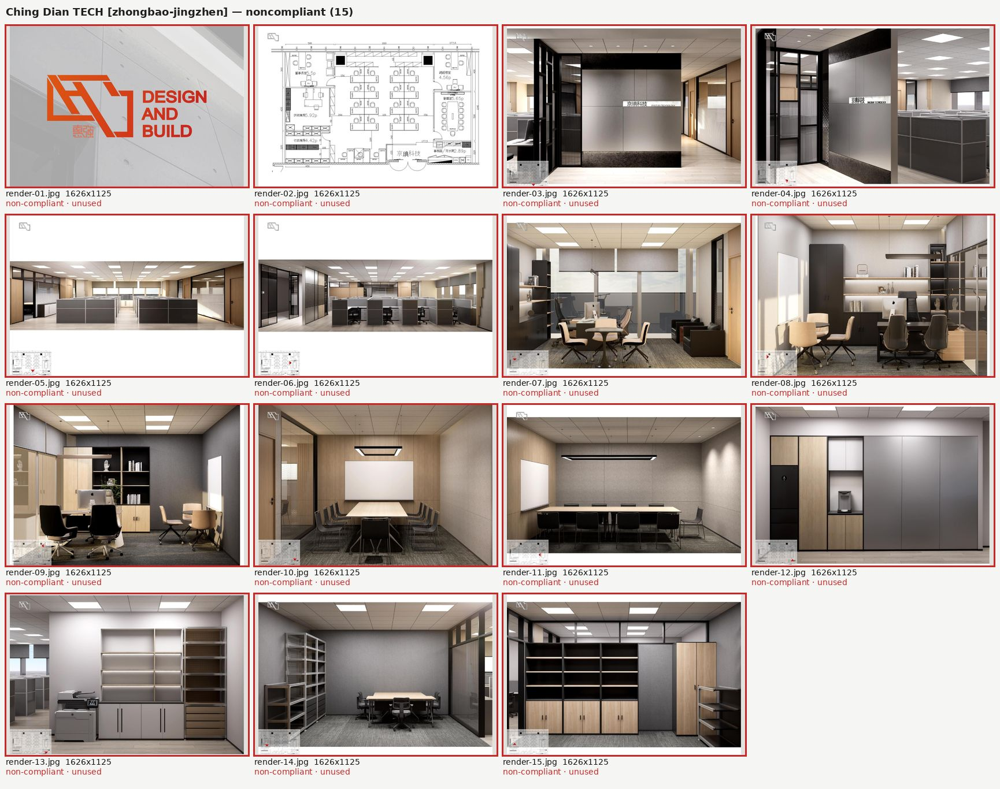

| 檔案 | 尺寸 | 狀態 | 不符原因 | 待補視角 | 建議路線 |
|---|---|---|---|---|---|
| `render-01.jpg` | 1626×1125 | unused | 簡報截圖：內嵌平面圖／浮水印／底部留白 | — | reference-only（構圖參考；非本輪必補視角） |
| `render-02.jpg` | 1626×1125 | unused | 簡報截圖：內嵌平面圖／浮水印／底部留白 | — | reference-only（構圖參考；非本輪必補視角） |
| `render-03.jpg` | 1626×1125 | unused | 簡報截圖：內嵌平面圖／浮水印／底部留白 | — | reference-only（構圖參考；非本輪必補視角） |
| `render-04.jpg` | 1626×1125 | unused | 簡報截圖：內嵌平面圖／浮水印／底部留白 | — | reference-only（構圖參考；非本輪必補視角） |
| `render-05.jpg` | 1626×1125 | unused | 簡報截圖：內嵌平面圖／浮水印／底部留白 | 開放工位 | regenerate（OpenAI edit：以此舊稿為構圖參考，去除平面圖／浮水印／留白） |
| `render-06.jpg` | 1626×1125 | unused | 簡報截圖：內嵌平面圖／浮水印／底部留白 | — | reference-only（構圖參考；非本輪必補視角） |
| `render-07.jpg` | 1626×1125 | unused | 簡報截圖：內嵌平面圖／浮水印／底部留白 | — | reference-only（構圖參考；非本輪必補視角） |
| `render-08.jpg` | 1626×1125 | unused | 簡報截圖：內嵌平面圖／浮水印／底部留白 | — | reference-only（構圖參考；非本輪必補視角） |
| `render-09.jpg` | 1626×1125 | unused | 簡報截圖：內嵌平面圖／浮水印／底部留白 | 獨立辦公室 | regenerate（OpenAI edit：以此舊稿為構圖參考，去除平面圖／浮水印／留白） |
| `render-10.jpg` | 1626×1125 | unused | 簡報截圖：內嵌平面圖／浮水印／底部留白 | 投影會議室 | regenerate（OpenAI edit：以此舊稿為構圖參考，去除平面圖／浮水印／留白） |
| `render-11.jpg` | 1626×1125 | unused | 簡報截圖：內嵌平面圖／浮水印／底部留白 | — | reference-only（構圖參考；非本輪必補視角） |
| `render-12.jpg` | 1626×1125 | unused | 簡報截圖：內嵌平面圖／浮水印／底部留白 | 茶水區 | regenerate（OpenAI edit：以此舊稿為構圖參考，去除平面圖／浮水印／留白） |
| `render-13.jpg` | 1626×1125 | unused | 簡報截圖：內嵌平面圖／浮水印／底部留白 | — | reference-only（構圖參考；非本輪必補視角） |
| `render-14.jpg` | 1626×1125 | unused | 簡報截圖：內嵌平面圖／浮水印／底部留白 | — | reference-only（構圖參考；非本輪必補視角） |
| `render-15.jpg` | 1626×1125 | unused | 簡報截圖：內嵌平面圖／浮水印／底部留白 | — | reference-only（構圖參考；非本輪必補視角） |

### SECOM Technology Hall · `zhongbao-showroom`

P1｜上線不合格 **0**｜合格 2｜距 6 張缺 **4**

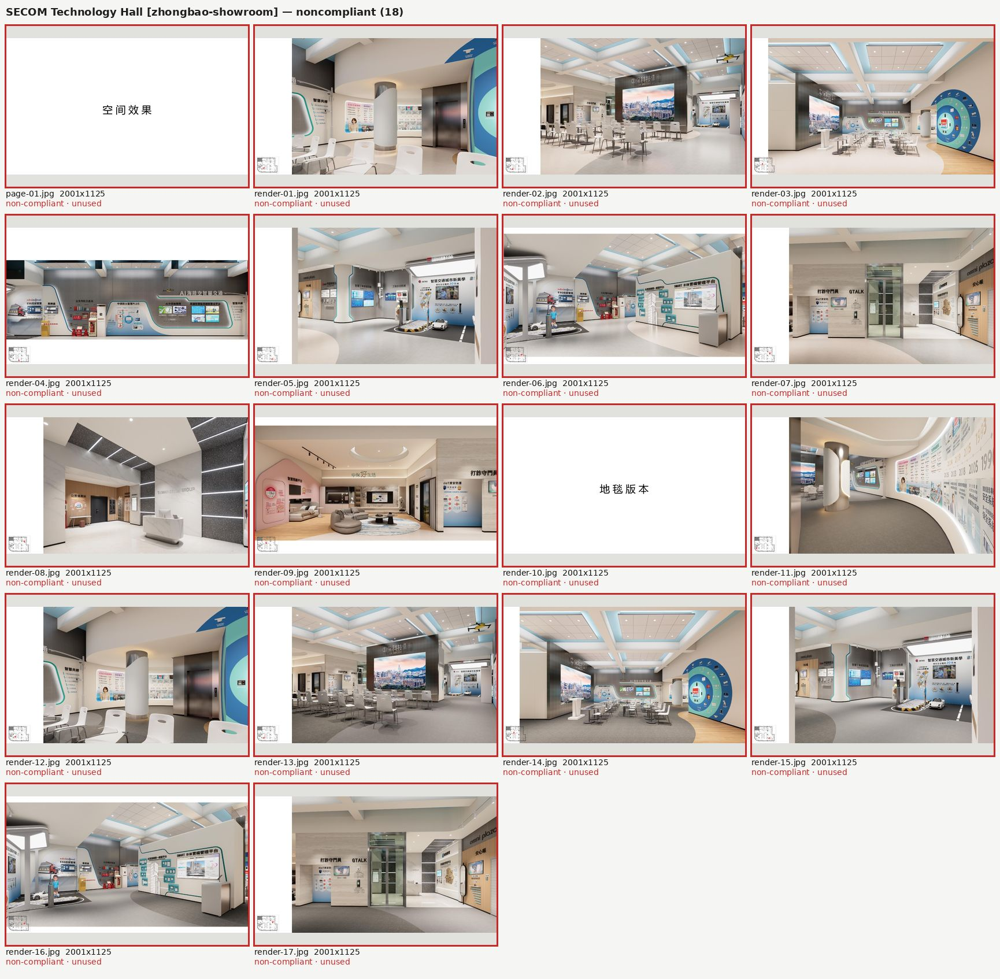

| 檔案 | 尺寸 | 狀態 | 不符原因 | 待補視角 | 建議路線 |
|---|---|---|---|---|---|
| `page-01.jpg` | 2001×1125 | unused | 簡報 logo 頁／封面截圖 | — | discard-from-gallery（logo 頁，不進相簿） |
| `render-01.jpg` | 2001×1125 | unused | 簡報截圖：內嵌平面圖／浮水印／底部留白 | 入口展區 | regenerate（OpenAI edit：以此舊稿為構圖參考，去除平面圖／浮水印／留白） |
| `render-02.jpg` | 2001×1125 | unused | 簡報截圖：內嵌平面圖／浮水印／底部留白 | — | reference-only（構圖參考；非本輪必補視角） |
| `render-03.jpg` | 2001×1125 | unused | 簡報截圖：內嵌平面圖／浮水印／底部留白 | 圓形互動牆 | regenerate（OpenAI edit：以此舊稿為構圖參考，去除平面圖／浮水印／留白） |
| `render-04.jpg` | 2001×1125 | unused | 簡報截圖：內嵌平面圖／浮水印／底部留白 | — | reference-only（構圖參考；非本輪必補視角） |
| `render-05.jpg` | 2001×1125 | unused | 簡報截圖：內嵌平面圖／浮水印／底部留白 | — | reference-only（構圖參考；非本輪必補視角） |
| `render-06.jpg` | 2001×1125 | unused | 簡報截圖：內嵌平面圖／浮水印／底部留白 | 設備展示區 | regenerate（OpenAI edit：以此舊稿為構圖參考，去除平面圖／浮水印／留白） |
| `render-07.jpg` | 2001×1125 | unused | 簡報截圖：內嵌平面圖／浮水印／底部留白 | — | reference-only（構圖參考；非本輪必補視角） |
| `render-08.jpg` | 2001×1125 | unused | 簡報截圖：內嵌平面圖／浮水印／底部留白 | 接待廳 | regenerate（OpenAI edit：以此舊稿為構圖參考，去除平面圖／浮水印／留白） |
| `render-09.jpg` | 2001×1125 | unused | 簡報截圖：內嵌平面圖／浮水印／底部留白 | — | reference-only（構圖參考；非本輪必補視角） |
| `render-10.jpg` | 2001×1125 | unused | 簡報截圖：內嵌平面圖／浮水印／底部留白 | — | reference-only（構圖參考；非本輪必補視角） |
| `render-11.jpg` | 2001×1125 | unused | 簡報截圖：內嵌平面圖／浮水印／底部留白 | — | reference-only（構圖參考；非本輪必補視角） |
| `render-12.jpg` | 2001×1125 | unused | 簡報截圖：內嵌平面圖／浮水印／底部留白 | — | reference-only（構圖參考；非本輪必補視角） |
| `render-13.jpg` | 2001×1125 | unused | 簡報截圖：內嵌平面圖／浮水印／底部留白 | — | reference-only（構圖參考；非本輪必補視角） |
| `render-14.jpg` | 2001×1125 | unused | 簡報截圖：內嵌平面圖／浮水印／底部留白 | — | reference-only（構圖參考；非本輪必補視角） |
| `render-15.jpg` | 2001×1125 | unused | 簡報截圖：內嵌平面圖／浮水印／底部留白 | — | reference-only（構圖參考；非本輪必補視角） |
| `render-16.jpg` | 2001×1125 | unused | 簡報截圖：內嵌平面圖／浮水印／底部留白 | — | reference-only（構圖參考；非本輪必補視角） |
| `render-17.jpg` | 2001×1125 | unused | 簡報截圖：內嵌平面圖／浮水印／底部留白 | — | reference-only（構圖參考；非本輪必補視角） |

### eSkylink · `zhongbao-tianhe`

P1｜上線不合格 **0**｜合格 2｜距 6 張缺 **4**

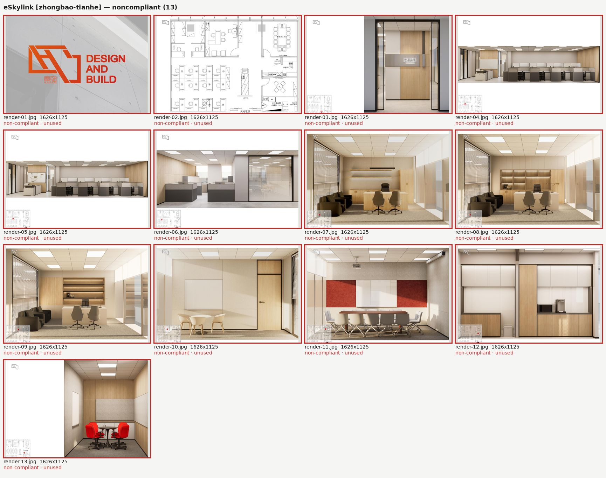

| 檔案 | 尺寸 | 狀態 | 不符原因 | 待補視角 | 建議路線 |
|---|---|---|---|---|---|
| `render-01.jpg` | 1626×1125 | unused | 簡報截圖：內嵌平面圖／浮水印／底部留白 | — | reference-only（構圖參考；非本輪必補視角） |
| `render-02.jpg` | 1626×1125 | unused | 簡報截圖：內嵌平面圖／浮水印／底部留白 | — | reference-only（構圖參考；非本輪必補視角） |
| `render-03.jpg` | 1626×1125 | unused | 簡報截圖：內嵌平面圖／浮水印／底部留白 | 入口門廳 | regenerate（OpenAI edit：以此舊稿為構圖參考，去除平面圖／浮水印／留白） |
| `render-04.jpg` | 1626×1125 | unused | 簡報截圖：內嵌平面圖／浮水印／底部留白 | — | reference-only（構圖參考；非本輪必補視角） |
| `render-05.jpg` | 1626×1125 | unused | 簡報截圖：內嵌平面圖／浮水印／底部留白 | — | reference-only（構圖參考；非本輪必補視角） |
| `render-06.jpg` | 1626×1125 | unused | 簡報截圖：內嵌平面圖／浮水印／底部留白 | 開放工位 | regenerate（OpenAI edit：以此舊稿為構圖參考，去除平面圖／浮水印／留白） |
| `render-07.jpg` | 1626×1125 | unused | 簡報截圖：內嵌平面圖／浮水印／底部留白 | — | reference-only（構圖參考；非本輪必補視角） |
| `render-08.jpg` | 1626×1125 | unused | 簡報截圖：內嵌平面圖／浮水印／底部留白 | — | reference-only（構圖參考；非本輪必補視角） |
| `render-09.jpg` | 1626×1125 | unused | 簡報截圖：內嵌平面圖／浮水印／底部留白 | — | reference-only（構圖參考；非本輪必補視角） |
| `render-10.jpg` | 1626×1125 | unused | 簡報截圖：內嵌平面圖／浮水印／底部留白 | — | reference-only（構圖參考；非本輪必補視角） |
| `render-11.jpg` | 1626×1125 | unused | 簡報截圖：內嵌平面圖／浮水印／底部留白 | — | reference-only（構圖參考；非本輪必補視角） |
| `render-12.jpg` | 1626×1125 | unused | 簡報截圖：內嵌平面圖／浮水印／底部留白 | 茶水區 | regenerate（OpenAI edit：以此舊稿為構圖參考，去除平面圖／浮水印／留白） |
| `render-13.jpg` | 1626×1125 | unused | 簡報截圖：內嵌平面圖／浮水印／底部留白 | 小會議室 | regenerate（OpenAI edit：以此舊稿為構圖參考，去除平面圖／浮水印／留白） |

## B. 規格偏離（實拍專案）

標準：效果圖長邊 ≥ 2400 px；實拍長邊 ≥ 2000 px（2026-11-22 決議，不足時以 `scripts/photo-audit/upscale_real_photos.py` 放大）。以下僅列上線中仍未達標者。

## C. 保留不顯示

`floorplan.jpg` 共 9 個：保留於 repo，待獨立 section，不進 gallery。
